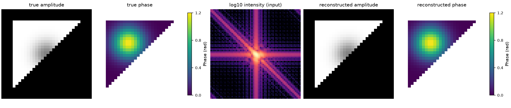

# QoraPhase

[](https://pypi.org/project/qoraphase/) [](https://github.com/NaNIsaac/QoraPhase/actions/workflows/ci.yml) [](LICENSE)

Estimate a complex object from a coherent diffraction intensity array using composable JAX phase-retrieval recipes.

<!-- overview:start -->
Full documentation: [QoraPhase](https://nanisaac.github.io/docs/qoraphase/).

A diffraction detector measures **how bright each part of a pattern is**, but
not the phase of the scattered X-ray wave. Without that phase, the pattern
cannot simply be Fourier-transformed into an image of the object. This is the
*phase-retrieval problem* in coherent diffraction imaging (CDI).

**QoraPhase estimates a possible object from the measured intensity.** It
iterates between diffraction-space measurements and real-space constraints
using algorithms such as ER, HIO, RAAR, and shrinkwrap. The result is a
complex-valued object: amplitude and phase. It accepts centred 2D or 3D
NumPy/JAX arrays, and can run on CPU or GPU.

A reconstruction that matches the measured intensity is **not automatically
the correct or unique object**. The synthetic example below shows what the code
can do; [measured-data checks remain unresolved](docs/benchmarks/cxidb.md).



A 64×64 simulated object, its noiseless intensity, and the best of 8 random
starts from `qp.reconstruct(intensity, starts=8)` with no support given (it is
derived from the autocorrelation and shrinkwrapped). Relative error against the
true object: 7.9e-7. Script: `examples/readme_figure.py`. This is a recorded synthetic example, not a new measured-data result.


## Start here

Read [installation](docs/install.md), the [tutorial](docs/tutorial.md) and [array conventions](docs/guides/arrays.md). Then use [recipes](docs/guides/recipes.md), [constraints](docs/guides/constraints.md), [diagnostics](docs/guides/diagnostics.md) and [alignment/PRTF](docs/guides/combining.md).

Manual benchmark reproduction is in [genetic algorithms](docs/guides/genetic.md) and [low-pass progression](docs/guides/low-pass.md). Read the [validation limits](docs/guides/validation.md), [report index](docs/reports/README.md) and [release history](https://github.com/NaNIsaac/QoraPhase/releases) before interpreting results. The documentation hub generates API reference pages from the package docstrings.
<!-- overview:end -->

## Install

Requires Python 3.12 or later and [uv](https://docs.astral.sh/uv/):

<!-- test -->
```sh
uv init --no-workspace --python 3.12 qoraphase-demo
uv add --directory qoraphase-demo qoraphase
```

For `Reconstruction.plot()` and figure scripts, add the optional `plot` extra (`uv add "qoraphase[plot]"` or `pip install "qoraphase[plot]"`).

## Quick start

This small API check reconstructs a centred synthetic Gaussian intensity, without a data file:

<!-- test console -->
```console
$ uv run -q --directory qoraphase-demo python -c "import numpy as np; import qoraphase as qp; y,x=np.indices((32,32))-16; result=qp.reconstruct(np.exp(-(x*x+y*y)/20)); print(result.amplitude.shape)"
(32, 32)
```

The shape confirms execution, not reconstruction accuracy. The [tutorial](docs/tutorial.md) compares with a known object. For your own data, pass a centred 2D/3D intensity array, with `mask=True` for unusable pixels and `support=True` inside the object.

## Documentation

- [Overview](docs/index.md), [installation](docs/install.md) and [tutorial](docs/tutorial.md).
- [Array conventions](docs/guides/arrays.md), [input contract](docs/input-contract.md) and [recipes](docs/guides/recipes.md).
- [Diagnostics](docs/guides/diagnostics.md), [constraints](docs/guides/constraints.md), [alignment and PRTF](docs/guides/combining.md).
- [Validation and limitations](docs/guides/validation.md), [research reports](docs/reports/README.md), [CPU performance](docs/perf.md) and [GPU environment](docs/hardware.md).
- Manual [genetic-algorithm](docs/guides/genetic.md) and [low-pass](docs/guides/low-pass.md) benchmark reproduction; results are preserved with their provenance.
- [Documentation site and generated API](https://nanisaac.github.io/docs/qoraphase/), [changelog](CHANGELOG.md), [release history](https://github.com/NaNIsaac/QoraPhase/releases) and [citation](CITATION.cff).

## License

MIT, see [LICENSE](LICENSE).
