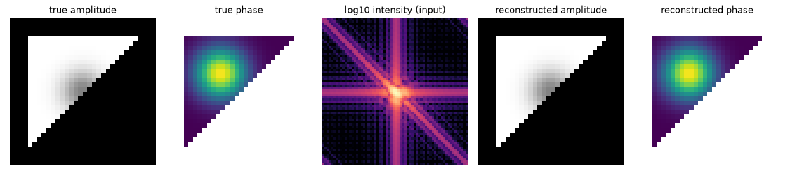

# QoraPhase

[](https://pypi.org/project/qoraphase/) [](https://github.com/NaNIsaac/QoraPhase/actions/workflows/ci.yml) [](LICENSE)

Estimate a complex object from a coherent diffraction intensity array using composable JAX phase-retrieval recipes.



Recorded synthetic, noiseless 64×64 example, best of 8 starts. A low intensity residual does not establish the correct or unique object; [measured-data checks remain unresolved](docs/benchmarks/cxidb.md).

## Install

Requires Python 3.12 or later and [uv](https://docs.astral.sh/uv/):

<!-- test -->
```sh
uv init --no-workspace --python 3.12 qoraphase-demo
uv add --directory qoraphase-demo qoraphase
```

## Quick start

This small API check reconstructs a centred synthetic Gaussian intensity, without a data file:

<!-- test console -->
```console
$ uv run -q --directory qoraphase-demo python -c "import numpy as np; import qoraphase as qp; y,x=np.indices((32,32))-16; result=qp.reconstruct(np.exp(-(x*x+y*y)/20)); print(result.amplitude.shape)"
(32, 32)
```

The shape confirms execution, not reconstruction accuracy. The [tutorial](docs/tutorial.md) compares with a known object. For your own data, pass a centred 2D/3D intensity array, with `mask=True` for unusable pixels and `support=True` inside the object.

## Documentation

- [Overview](docs/index.md), [installation](docs/install.md) and [tutorial](docs/tutorial.md).
- [Array conventions](docs/guides/arrays.md), [input contract](docs/input-contract.md) and [recipes](docs/guides/recipes.md).
- [Diagnostics](docs/guides/diagnostics.md), [constraints](docs/guides/constraints.md), [alignment and PRTF](docs/guides/combining.md).
- [Validation and limitations](docs/guides/validation.md), [research reports](docs/reports/README.md), [CPU performance](docs/perf.md) and [GPU environment](docs/hardware.md).
- Manual [genetic-algorithm](docs/guides/genetic.md) and [low-pass](docs/guides/low-pass.md) benchmark reproduction; results are preserved with their provenance.
- [Documentation site and generated API](https://nanisaac.github.io/docs/qoraphase/), [release history](https://github.com/NaNIsaac/QoraPhase/releases) and [citation](CITATION.cff).

## License

MIT, see [LICENSE](LICENSE).
