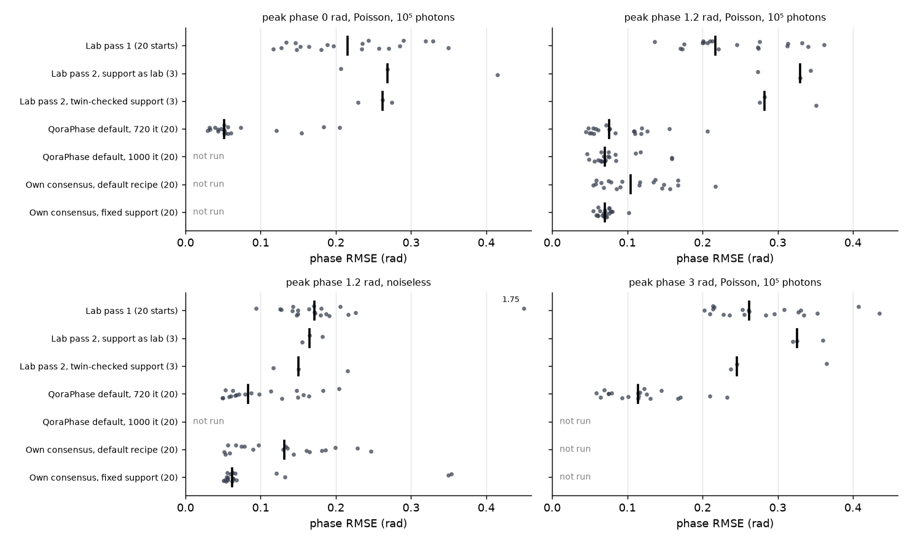
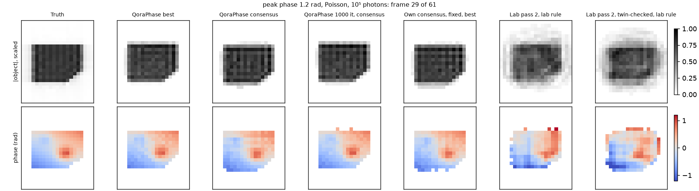

# A lab ER/HIO shrinkwrap recipe against the QoraPhase default recipe on simulated 3D Bragg CDI data

QoraPhase benchmark note, 2026-11-04. Code: `benchmarks/bcdi_lab.py` (runs) and
`benchmarks/bcdi_lab_figures.py` (figures).

## Abstract

We asked whether QoraPhase's default phase-retrieval recipe recovers the strain phase of a
Bragg coherent diffraction imaging (BCDI) data set as well as a two-pass ER/HIO shrinkwrap
recipe written in MATLAB and used in our laboratory. The lab recipe was re-implemented in JAX
from reading its source. Both recipes were applied to simulated 3D data of one particle
(asymmetric, 250 nm, 61 × 128 × 128 detector voxels) and scored against the known object: at a
peak phase of 1.2 rad noiseless and with Poisson noise at 10⁵ photons in the brightest voxel,
and at peak phases of 0 and 3 rad with Poisson noise. Reconstructions were registered to the
truth to 0.01 voxel before scoring. At 1.2 rad and 10⁵ photons the default recipe gave a median
phase RMSE of 0.055 rad over 20 starts (0.051 rad when run for the lab's 1000 iterations),
against 0.17–0.26 rad for the outputs of the lab recipe (two support variants, each with two
seed-choice rules). Without noise it gave 0.048 rad against 0.11–0.16 rad, and at 0 and 3 rad
0.042 and 0.061 rad against 0.21–0.30 and 0.19–0.29 rad. Of the 80 default starts over the four
cases, 79 had a lower phase error than every second-pass run of the lab recipe on the same case.
A twin check in the lab's support averaging improved its output in every case. Restarting
QoraPhase from a twin-checked consensus of its own 20 final supports gave no consistent
improvement on the default: with the support held fixed the noiseless median was lower (0.041
against 0.048 rad) at the cost of four runs at 0.09–0.27 rad, and there was no gain at 10⁵
photons or with shrinkwrap. The lab outputs are single runs, and
with a different jax release single runs moved by up to 0.19 rad at fixed seeds. With one
particle shape and one noise realisation per case, these results indicate a direction, not a
general ranking.

## 1 Introduction

In BCDI a nanocrystal is illuminated by a coherent X-ray beam and the 3D intensity around one
Bragg peak is recorded by rocking the crystal through the peak [4]. The detector measures only
the intensity $I(\mathbf q) = |\mathcal F\rho(\mathbf q)|^2$ of the complex object
$\rho(\mathbf r) = |\rho(\mathbf r)|\,e^{i\phi(\mathbf r)}$. The phase
$\phi = \mathbf Q\cdot\mathbf u$ encodes the lattice displacement $\mathbf u$ along the
scattering vector $\mathbf Q$, which is why its recovery is the goal. Phase retrieval restores
the missing Fourier phase by iterating between two constraints: the *modulus constraint* (the
Fourier magnitude must equal $\sqrt I$; projection $P_M$) and the *support constraint* (the
object is zero outside a region $S$, the *support*; projection $P_S$).

The algorithms used here are:

- **ER** (error reduction), $x_{n+1} = P_S P_M x_n$ [1].
- **HIO** (hybrid input–output) [1]: $x_{n+1} = P_M x_n$ inside $S$ and
  $x_n - \beta P_M x_n$ outside, with feedback $\beta$.
- **RAAR** (relaxed averaged alternating reflections) [3]:
  $x_{n+1} = \tfrac{\beta}{2}(R_S R_M + I)x_n + (1-\beta)P_M x_n$, $R = 2P - I$.
- **Shrinkwrap** [2]: the support is periodically replaced by the region where the
  Gaussian-blurred object amplitude exceeds a threshold, so a loose initial support (here
  derived from the autocorrelation, the inverse transform of $I$) contracts onto the object.
- **Twin**: $\rho(\mathbf r)$ and $\rho^*(-\mathbf r)$ have the same $|\mathcal F\rho|$, so a run
  can converge to either; the twin's support is the point reflection of the true one, up to a
  shift.

The lab recipe is in use on experimental data. Before QoraPhase replaces it, we need to know
whether the default recipe is at least as accurate on data for which the true object is known,
and which parts of the lab recipe, if any, should be carried over.

## 2 Methods

### 2.1 Simulated data

Data were generated with rocking_xrd_sim (`bench.make_cases`, commit `65ac18d`), a simulator
in a private repository. The object is a
faceted asymmetric particle 250 nm across (voxel 156.25 Å, 16 voxels across on the simulation
grid, about 15 px in the reconstruction frame) with $\rho = \chi_\Omega\,e^{i\phi}$. The phase is
a sum of linear, bilinear and two off-centre Gaussian terms, mean-free over the particle and
scaled so that $\max|\phi| = 1.2$ rad; two further cases use 0 rad (no strain) and 3 rad.
Diffraction geometry: 5.55 keV ($\lambda$ = 2.234 Å), $2\theta$ = 69°, rocking angle
34.2°–34.8° in 0.01° steps (61 frames), detector at 0.511 m with 128 × 128 pixels of 55 µm. Two
doses were used: noiseless, and intensities scaled so that the brightest voxel holds 10⁵
photons, followed by one Poisson draw (NumPy generator, seed 0). The noiseless frames stay in
the simulator's units (brightest voxel 5.56 × 10⁶). The 1.2 rad case was run at both doses,
the 0 and 3 rad cases at 10⁵ photons only.
Readout noise, background, beamstop, partial coherence and detector point spread were not
modelled. The reference object is the inverse DFT of the complex scattering amplitude sampled
at each detector voxel, that is, the object in the frame the reconstructions live in. That grid
is neither cubic nor orthogonal: the rocking axis is coupled to the detector rows, and the
voxel is about 162 Å across in the detector plane but has a different, sheared pitch along the
rocking direction. Every metric below counts voxels of this grid, every blur width in px is
anisotropic in physical units, and the slices in Figure 2 are distorted.

### 2.2 Lab recipe (re-implemented, not run in MATLAB)

The input amplitude is $F = \sqrt{I}$, with $F \le 1$ set to 0 in pass 1. Since the noiseless
frames are not scaled to photons, this cut removes a lower relative level there than at 10⁵
photons.

*Pass 1 (support estimate).* The start support is $|\mathcal F(F^2)|$, blurred with a Gaussian
($\sigma$ = 5 px), thresholded at min + 0.05 (max − min). We ran 20 random starts, each with
1000 iterations in 11 blocks alternating ER and HIO (20, 180, 20, 180, …, 20; HIO
$\beta$ = 0.9, complex object, no positivity). During blocks 1–6 (600 iterations):

- shrinkwrap runs every 20 iterations: the amplitude after the modulus step is blurred
  ($\sigma$ = 2 px, finite kernel, replicated edges) and thresholded at min + $t$(max − min),
  with $t$ = 0.10, 0.11, …, 0.15 per block, then intersected with the start support;
- the data are multiplied by a Gaussian window in $q$, $W$, whose width grows linearly from
  0.8 to 2.0 times the half array size.

The 20 final supports are shifted onto the first (cross-correlation peak to 0.1 px, clamped to
±5 px), clipped to [0, 1], summed, and thresholded at 20 % of the maximum.

*Pass 2 (phasing).* The same schedule, including the $q$ window in blocks 1–6, with the raw
$F$, the summed support held fixed and no shrinkwrap, over 3 seeds. The seed with the lowest best-so-far error is kept, and its last
iterate is the result.

*Deviations from the lab code:*

- the random start phase varies in all three dimensions (the lab's is constant along the third
  axis, a defect);
- the cross-correlation shift and the clipping replace the lab's L1 fit and de-ringing;
- the first support is counted once (the lab counts it twice);
- the support sum is run twice, as written and with a twin check, in which the point-reflected
  support is also tried and the closer one kept.

*Seed choice.* The error is

$$E_{\mathrm{lab}} = \frac{\sum_{\mathbf q}\big|F W - |\mathcal F(P_S x)|\big|}{\sum_{\mathbf q} F W}.$$

The *lab rule* uses $W$ as above, so errors from the windowed blocks are on a different scale.
The *unwindowed rule* sets $W = 1$ at every iteration. Only iterations after the 5th are
eligible.

### 2.3 QoraPhase recipes

The default recipe is `default_recipe()` of QoraPhase 0.2.0:

RAAR(50) → detwin[HIO(20)] → RAAR(50) → 8 × [RAAR(50) + Shrinkwrap] → ER(200)

That is 720 iterations, with RAAR and HIO $\beta$ = 0.9. Detwin runs HIO on the support cut in
half along axis 0 and then restores it. Shrinkwrap thresholds the blurred amplitude
($\sigma$ = 1 px, periodic Fourier blur) at 0.3 × max. The start support is
$|\mathcal F^{-1} I| > 0.1\max$. QoraPhase's own error, reported for scale only, is

$$E_F = \Big(\sum_{\mathbf q}(|\mathcal F x| - F)^2 / \sum_{\mathbf q}F^2\Big)^{1/2}.$$

Two variants were also run, each with 20 starts:

- **1000 iterations** (10⁵ photons only): the eight shrinkwrap rounds run RAAR(85) instead of
  RAAR(50), so the recipe has the lab's 1000 iterations and still updates the support eight
  times.
- **Own consensus** (both doses): the 20 final supports of the default run are combined like the
  lab's pass 1 supports, with the twin check, and the result is the start support of a second
  set of 20 starts, once with the default recipe and once with its shrinkwrap rounds replaced by
  the same 400 RAAR iterations, so the support stays fixed (the analogue of the lab's pass 2).

Each 20-start set yields two single outputs: `best`, the lowest final $E_F$, and `consensus`,
the run with the smallest mean distance to the other runs after alignment.

### 2.4 Accuracy metrics

Scores come from `bench.detframe.score` of rocking_xrd_sim (commit `f7c543f`). Each
reconstruction $\hat\rho$ is aligned to the truth $\rho$. Translation by any fraction of a voxel,
the twin, the global phase and a linear phase ramp leave $|\mathcal F\hat\rho|$ unchanged, so
all four are removed. Both $\hat\rho$ and its twin are shifted by the integer peak of the amplitude
cross-correlation, then by a fractional shift to 0.01 voxel that maximises the complex overlap
with $\rho$, evaluated by a DFT on a fine grid of shifts near the peak. That step alternates three
times with the fit of the global phase and the ramp, because a ramp moves the overlap peak. The
ramp is a least-squares fit of the phase difference on $S_{0.5} = \{|\rho| > 0.5\max|\rho|\}$,
weighted by $|\hat\rho||\rho|$. Of the two candidates, the one with the larger overlap with $\rho$
on $S_{0.5}$ is kept. The amplitude is then rescaled by
$s = \langle|\hat\rho|,|\rho|\rangle/\||\hat\rho|\|^2$. With supports
$S_t = \{|\rho| > 0.3\max|\rho|\}$ and $S_r$ (the same for $s|\hat\rho|$), and $N_t = |S_t|$:

$$\mathrm{IoU} = \frac{|S_r\cap S_t|}{|S_r\cup S_t|}$$

$$\mathrm{NRMSE}_A = \frac{\|s|\hat\rho| - |\rho|\|_{S_r\cup S_t}}{\||\rho|\|_{S_t}}$$

$$\mathrm{RMSE}_\phi = \Big(\frac{1}{N_t}\sum_{S_t}\arg^2(\hat\rho\,\rho^*)\Big)^{1/2}$$

$$\mathrm{NRMSE}_c = \frac{\|c\hat\rho - \rho\|}{\|\rho\|},\quad c = \frac{\langle\hat\rho,\rho\rangle}{\|\hat\rho\|^2}$$

$\arg$ is wrapped to $(-\pi,\pi]$. The phase retrieval transfer function (PRTF) [5] over each
set of runs was also computed (`qp.prtf`, 1/e crossing).

Because the ramp is removed, these scores do not see an error in the object's linear phase
term, that is, in a homogeneous strain. A wrong ramp would move the diffraction pattern of
$\hat\rho$ against that of $\rho$. That offset, centroid to centroid, was at most 0.053
voxels in every run. An offset of $\delta$ voxels on an axis of $N$ voxels is a ramp of
$2\pi\delta L/N$ across a particle $L$ voxels long, so the removed ramp is at most about 0.04
rad across the particle along the 128-pixel detector axes and about 0.08 rad along the 61-frame
rocking axis.

### 2.5 Software, hardware and reproducibility

All runs were single CPU processes in float32 (x64 off) on an AMD Ryzen 5 7500F (6 cores,
12 threads, 31.6 GB RAM) under Windows 11 (10.0.26300), on 2026-11-04. Software, from the
project lock file: Python 3.14.5 (GIL build), jax and jaxlib 0.11.1, NumPy 2.5.2, SciPy 1.18.1.
JAX random keys were split from seed 0 (pass 1 and QoraPhase) and seed 1 (pass 2). Wall times
include compilation.

*Determinism.* Two runs of the 10⁵ case in this environment, 15 minutes apart and with other
jobs on the machine during the second, gave identical scores for every start of every method.
The final run, about two hours later, reproduced every QoraPhase Fourier error and support of
the earlier runs of all four cases exactly. At fixed seeds the results are deterministic within
one environment.

*Version sensitivity.* A first run of the same script on 2026-11-02 used jax and jaxlib
0.12.0.1 on Python 3.13 (outside the lock). With the same seeds, single runs differed between
the two environments by up to 0.19 rad in phase RMSE, and medians by up to 0.03 rad (both
scored with whole-voxel registration, which adds jitter of its own). The two environments
therefore produce different random draws or different floating-point paths from the same seed,
and a single run is not a reproducible quantity across versions. This applies to the lab
recipe's outputs, which are single chosen runs: at 1.2 rad and 10⁵ photons its three pass-2
seeds on the twin-checked support spanned 0.185–0.288 rad on 2026-11-02 and 0.274–0.351 rad in
the locked environment (whole-voxel scores, so not comparable with Table 1). The
ranking of the methods was the same in both. All numbers below are from the locked environment.

## 3 Results

Tables 1 and 2 give the accuracy at 1.2 rad for the two doses, Table 3 at 0 and 3 rad. For 20-run sets we report the median, the
interquartile range [Q1–Q3] and, for the phase, the min–max range over starts. For pass 2 of
the lab recipe we report the seed chosen by each rule, with all three seeds given for the phase.
The lab recipe's output is pass 2; pass 1 is shown for reference. Phase is in rad; the other
metrics are dimensionless. Lower is better, except for IoU.

**Table 1.** Peak phase 1.2 rad, 10⁵ photons.

| Method | Phase RMSE (rad) | Amplitude NRMSE | Support IoU | Complex NRMSE |
|---|---|---|---|---|
| Lab pass 1, 20 runs | 0.191 [0.151–0.219] (0.113–0.280) | 0.207 [0.186–0.234] | 0.899 [0.880–0.936] | 0.316 [0.279–0.343] |
| Lab pass 2, support as lab (4911 vx), lab rule | 0.264 (seeds 0.230–0.312) | 0.238 | 0.888 | 0.408 |
| ditto, unwindowed rule | 0.230 | 0.255 | 0.880 | 0.409 |
| Lab pass 2, twin-checked support (4568 vx), lab rule | 0.253 (seeds 0.170–0.253) | 0.255 | 0.856 | 0.418 |
| ditto, unwindowed rule | 0.170 | 0.199 | 0.909 | 0.329 |
| QoraPhase default, 720 it, 20 runs | 0.055 [0.048–0.062] (0.035–0.067) | 0.072 [0.067–0.077] | 0.985 [0.982–0.985] | 0.116 [0.115–0.119] |
| QoraPhase default, 720 it, `best` / `consensus` | 0.046 / 0.050 | 0.067 / 0.078 | 0.985 / 0.985 | 0.111 / 0.118 |
| QoraPhase default, 1000 it, 20 runs | 0.051 [0.047–0.059] (0.038–0.063) | 0.071 [0.070–0.074] | 0.984 [0.984–0.986] | 0.117 [0.112–0.119] |
| QoraPhase default, 1000 it, `best` / `consensus` | 0.052 / 0.038 | 0.068 / 0.059 | 0.984 / 0.985 | 0.113 / 0.104 |
| Own consensus (2140 vx) → default recipe, 20 runs | 0.054 [0.051–0.058] (0.041–0.068) | 0.072 [0.067–0.076] | 0.984 [0.982–0.985] | 0.116 [0.112–0.120] |
| ditto, `best` / `consensus` | 0.058 / 0.054 | 0.062 / 0.071 | 0.989 / 0.984 | 0.109 / 0.114 |
| Own consensus (2140 vx) → fixed support, 20 runs | 0.059 [0.055–0.065] (0.038–0.072) | 0.069 [0.065–0.073] | 0.985 [0.983–0.986] | 0.117 [0.113–0.119] |
| ditto, `best` / `consensus` | 0.045 / 0.070 | 0.065 / 0.063 | 0.987 / 0.982 | 0.105 / 0.118 |

**Table 2.** Peak phase 1.2 rad, noiseless.

| Method | Phase RMSE (rad) | Amplitude NRMSE | Support IoU | Complex NRMSE |
|---|---|---|---|---|
| Lab pass 1, 20 runs | 0.124 [0.106–0.139] (0.086–1.703) | 0.120 [0.110–0.128] | 0.962 [0.955–0.968] | 0.231 [0.205–0.244] |
| Lab pass 2, support as lab (3525 vx), lab rule | 0.149 (seeds 0.115–0.162) | 0.174 | 0.946 | 0.282 |
| ditto, unwindowed rule | 0.162 | 0.191 | 0.927 | 0.307 |
| Lab pass 2, twin-checked support (3460 vx), lab rule | 0.118 (seeds 0.114–0.148) | 0.095 | 0.978 | 0.207 |
| ditto, unwindowed rule | 0.114 | 0.104 | 0.961 | 0.205 |
| QoraPhase default, 720 it, 20 runs | 0.048 [0.043–0.051] (0.033–0.058) | 0.075 [0.071–0.078] | 0.981 [0.979–0.983] | 0.118 [0.113–0.119] |
| QoraPhase default, 720 it, `best` / `consensus` | 0.034 / 0.033 | 0.071 / 0.074 | 0.981 / 0.981 | 0.110 / 0.113 |
| Own consensus (2380 vx) → default recipe, 20 runs | 0.050 [0.042–0.055] (0.037–0.072) | 0.076 [0.070–0.081] | 0.981 [0.980–0.984] | 0.119 [0.115–0.122] |
| ditto, `best` / `consensus` | 0.040 / 0.055 | 0.069 / 0.072 | 0.987 / 0.981 | 0.109 / 0.118 |
| Own consensus (2380 vx) → fixed support, 20 runs | 0.041 [0.039–0.045] (0.031–0.269) | 0.059 [0.058–0.061] | 0.984 [0.982–0.985] | 0.099 [0.099–0.102] |
| ditto, `best` / `consensus` | 0.041 / 0.038 | 0.062 / 0.059 | 0.985 / 0.984 | 0.101 / 0.099 |

**Table 3.** Peak phase 0 and 3 rad, 10⁵ photons.

| Method | Phase RMSE (rad) | Amplitude NRMSE | Support IoU | Complex NRMSE |
|---|---|---|---|---|
| *0 rad* | | | | |
| Lab pass 1, 20 runs | 0.171 [0.114–0.208] (0.083–0.298) | 0.183 [0.149–0.218] | 0.921 [0.896–0.944] | 0.292 [0.235–0.324] |
| Lab pass 2, support as lab (4650 vx), both rules | 0.303 (seeds 0.212–0.303) | 0.309 | 0.798 | 0.467 |
| Lab pass 2, twin-checked support (3705 vx), both rules | 0.213 (seeds 0.194–0.243) | 0.272 | 0.833 | 0.373 |
| QoraPhase default, 720 it, 20 runs | 0.042 [0.037–0.050] (0.025–0.060) | 0.075 [0.072–0.079] | 0.984 [0.983–0.984] | 0.114 [0.113–0.118] |
| QoraPhase default, 720 it, `best` / `consensus` | 0.032 / 0.028 | 0.074 / 0.075 | 0.985 / 0.981 | 0.113 / 0.111 |
| *3 rad* | | | | |
| Lab pass 1, 20 runs | 0.205 [0.179–0.264] (0.157–0.390) | 0.209 [0.177–0.252] | 0.910 [0.882–0.941] | 0.338 [0.300–0.397] |
| Lab pass 2, support as lab (5019 vx), lab rule | 0.246 (seeds 0.246–0.301) | 0.258 | 0.870 | 0.421 |
| ditto, unwindowed rule | 0.292 | 0.270 | 0.863 | 0.439 |
| Lab pass 2, twin-checked support (3845 vx), lab rule | 0.193 (seeds 0.193–0.310) | 0.197 | 0.914 | 0.313 |
| ditto, unwindowed rule | 0.232 | 0.228 | 0.889 | 0.364 |
| QoraPhase default, 720 it, 20 runs | 0.061 [0.057–0.063] (0.051–0.707) | 0.075 [0.072–0.078] | 0.984 [0.981–0.987] | 0.121 [0.117–0.123] |
| QoraPhase default, 720 it, `best` / `consensus` | 0.058 / 0.062 | 0.073 / 0.065 | 0.987 / 0.988 | 0.117 / 0.114 |



**Figure 1.** Phase RMSE of every start. Dots are single runs (jittered vertically), bars are
medians. Values above 0.45 rad are drawn at the edge and labelled.



**Figure 2.** One detector-frame slice through the centre of the particle at 10⁵ photons, after
alignment to the truth. Top: amplitude scaled to each object's maximum. Bottom: phase where the
amplitude exceeds 0.3. The lab outputs are the pass-2 seeds chosen by the lab rule.

**Spread.** The default ensembles are narrow: interquartile ranges of 0.006–0.014 rad, and every
start within 0.025–0.072 rad except one at 3 rad (0.707 rad). That start fails on every metric
(IoU 0.74, amplitude NRMSE 0.43, complex NRMSE 0.61) with a normal support of 1975 voxels, and
it ended at a Fourier error of 0.0745, inside the range of the set (0.0730–0.0750), so $E_F$
does not flag it; `best` and `consensus` both avoided it. Its cause was not investigated: a
partially twinned solution and a misregistration by the scorer (a wrong integer peak, which the
sub-voxel search within ±1 voxel cannot correct) are both possible.

**Twin convergence.** In the lab's support sum, the pass-1 supports that matched the first one
better after point reflection were 8 of 20 (1.2 rad, 10⁵), 4 of 20 (1.2 rad, noiseless) and 11
of 20 (0 and 3 rad). The twin-checked support was smaller by 7 %, 2 %, 20 % and 23 %. It
improved the chosen pass-2 output in every case and under both rules: at 0 rad from 0.303 to
0.213 rad, at 3 rad from 0.246 to 0.193 rad (lab rule), without noise from 0.149 to 0.118 rad,
and at 1.2 rad and 10⁵ photons from 0.264 to 0.253 rad (lab rule) and 0.230 to 0.170 rad
(unwindowed rule). With three seeds per support, the gain at 1.2 rad and 10⁵ photons is within
the seed spread.

**Seed choice.** Under the lab rule the best-so-far error fell inside the windowed phase in all
80 pass-1 and 24 pass-2 runs: at iteration 219 in 77 pass-1 runs and 419 in the other 3 (all
noiseless), and at 220 in 23 pass-2 runs and 81 in one. Under the unwindowed rule it fell outside
the window in 77 of 80 pass-1 runs and in all 24 pass-2 runs. The two rules chose different
pass-2 seeds in 6 of 8 cases. Neither rule was consistently better.

**Equal iterations.** At 10⁵ photons, running the default recipe for 1000 iterations instead of
720 moved the median phase RMSE from 0.055 to 0.051 rad (IQR 0.014 → 0.012 rad); the gap to the
lab recipe is not an effect of the iteration count.

**Own consensus.** When QoraPhase's own 20 final supports were combined, 8 of 20 matched the
first one better after point reflection at both doses: QoraPhase's runs also end in either twin
orientation. The scores do not see this, because the alignment picks the twin. The consensus
support had 2140 (10⁵) and 2380 (noiseless) voxels, against 1980–2041 for the single final
supports it was built from.

- *Support fixed.* At 10⁵ photons the ensemble was no better than the default (median 0.059
  against 0.055 rad, IQR 0.010 against 0.014 rad). Without noise 16 of 20 runs reached
  0.031–0.046 rad, below the default's median of 0.048 rad, all with $E_F$ 0.0422–0.0425; the
  other four (0.093–0.269 rad) ended at $E_F$ 0.049–0.054, so `best` picks a good run. At
  10⁵ photons $E_F$ (0.0765–0.0774) does not separate the runs.
- *Shrinkwrap on.* The ensemble matched the plain default (median 0.054 and 0.050 rad).
  Shrinkwrap tightened the support back to 1970–2043 voxels.

**Supports.**

| Support | Voxels |
|---|---|
| Lab start support | 19 297 (1.2 rad), 19 267 (0 rad), 19 467 (3 rad) |
| Lab pass-1 final | 3129–3290 (1.2 rad, 10⁵), 3163–3289 (1.2 rad, noiseless), 3127–3264 (0 rad), 3190–3376 (3 rad) |
| QoraPhase final (default) | 1984–2041 (1.2 rad, 10⁵), 1980–2031 (1.2 rad, noiseless), 1960–2051 (0 rad), 1950–2035 (3 rad) |
| Consensus of QoraPhase's final supports | 2140 (1.2 rad, 10⁵), 2380 (1.2 rad, noiseless) |

**Fourier error.** QoraPhase's $E_F$ ended at 0.078–0.080 (1.2 rad, 10⁵), 0.049–0.051
(noiseless), 0.079–0.081 (0 rad) and 0.073–0.075 (3 rad).

**PRTF.** The PRTF stayed above 1/e to the array edge for every set except lab pass 1 at 10⁵
photons (crossing 0.43–0.48 cycles/px). It does not discriminate between the methods here.

**Run time** (CPU, 20 starts in batches of 5, including compilation; final run, with no other
heavy jobs on the machine):

| Run | Wall time | Per start-iteration |
|---|---|---|
| Lab pass 1 (20 × 1000 iterations) | 366–368 s | 18 ms |
| Lab pass 2 (3 × 1000 iterations) | 48–50 s | 16–17 ms |
| QoraPhase default (20 × 720 iterations) | 161–167 s | 11–12 ms |
| QoraPhase default, 1000 iterations (20 × 1000) | 220 s | 11 ms |

Building the own consensus took about 1 s and each own-consensus restart 162–166 s.

## 4 Discussion

In every case the default recipe's median run has between a seventh and a third of the phase
error of the lab output as written (lab support, lab rule), and better amplitude and support
scores. The ratio is smallest without strain (0.042 rad against 0.303 rad) and largest without
noise (0.048 against 0.149 rad). The comparison does not depend on taking a median against one
chosen lab run: 79 of the 80 default starts beat every one of the six pass-2 runs of their case,
including the twin-checked ones, and `best` and `consensus` did in every case. Running the default
for the lab's 1000 iterations changes little, so the difference is not one of compute.

Registration matters for these numbers. Aligned only to whole voxels, the same reconstructions
scored up to 3.4 times as high (0.186 against 0.055 rad for one noiseless own-consensus
output, 0.115 against 0.058 rad for `best` at 3 rad), and the noiseless default ensemble looked
bimodal (IQR 0.062–0.148 rad); registered to 0.01 voxel it
spans 0.033–0.058 rad. [Default recipe on simulated BCDI data](../bcdi-support.md) reported two
groups of runs with the same whole-voxel scorer; rescored with this registration, they were an
artefact of it.

Two properties of the lab recipe plausibly account for part of its deficit (inference):

- its support sum adds twin-converged supports unflipped, which blurs the fixed support;
- its seed choice compares errors computed against differently windowed data, so in practice
  the choice is made at a low-resolution iteration.

The twin check removes the first and improved every case, most where many pass-1 runs ended as
twins (11 of 20 at 0 and 3 rad). It does not close the gap: even twin-checked, the lab's fixed
supports (3460–4568 voxels) are 1.5–2.1 times the consensus of QoraPhase's own supports and
about 1.7–2.3 times its single final supports (1950–2051 voxels), and the pass-2 result is
limited by that support (inference).

The own-consensus runs do not support adding a lab-style second pass to QoraPhase. With the
default ensemble already within an interquartile range of 0.014 rad, a fixed consensus support
left little to gain: no change at 10⁵ photons, and without noise a lower median (0.041 against
0.048 rad) bought with four runs in a worse group, which $E_F$ does flag there. Letting shrinkwrap
run again in the second pass returned the default's result.

Limitations:

1. **Simulation only.** No experimental data; the noise model is Poisson only.
2. **One particle.** One shape and size, three strain amplitudes, one Poisson realisation per
   case. The equal-iteration and own-consensus variants were run at 1.2 rad only.
   [Default recipe on simulated BCDI data](../bcdi-support.md) shows that results on this
   simulator change with shape and size.
3. **Few seeds.** Pass 2 has three seeds, so differences within that range are not significant.
   No statistical test was applied.
4. **Not the lab code itself.** The lab recipe is a re-implementation checked by reading the
   code, not against a MATLAB run, and two of its steps (alignment, de-ringing) were
   substituted.
5. **Environment.** One Windows CPU in float32. Single runs, including every lab output, are
   not reproducible across jax versions (Section 2.5); the medians moved by up to 0.03 rad.
6. **Unequal iterations.** The noiseless, 0 rad and 3 rad comparisons are 1000 (lab) against
   720 (QoraPhase) iterations; only 1.2 rad at 10⁵ photons was repeated at 1000.
7. **Private generator and scorer.** rocking_xrd_sim, which made the data and scores the
   results, is in a private repository. The case parameters are given above, but the runs cannot
   be reproduced from this repository alone.
8. **Grid.** All metrics are counted on the non-cubic, non-orthogonal detector-conjugate grid
   (Section 2.1), not in physical units.
9. **Linear phase.** The scores ignore the linear phase term, so a homogeneous strain error is
   not measured; the diffraction-pattern offset bounds it (Section 2.4).

## 5 Conclusion

On simulated BCDI data of one particle, QoraPhase's default recipe recovered the strain phase
more accurately than a re-implementation of the lab's ER/HIO shrinkwrap recipe in all four
cases, comparing the default's median with the lab outputs: at 1.2 rad 0.055 rad (0.051 rad at
equal iterations) against 0.17–0.26 rad at 10⁵ photons and 0.048 rad against 0.11–0.16 rad
without noise; at 0 and 3 rad 0.042 and 0.061 rad against 0.21–0.30 and 0.19–0.29 rad. All but
one of the 80 default starts also beat every lab second-pass run. The lab's support averaging
needs a twin check, which helped in every case but left it well behind. A lab-style second pass
on a consensus of QoraPhase's own supports gave no consistent improvement on the default. Scores of this kind
need sub-voxel registration: whole-voxel alignment inflated them by up to a factor of 3.4 and
made a narrow ensemble look bimodal. More shapes and noise draws are needed before the result
can be generalised.

## Reproduce

```
ROCKING_XRD_SIM=<checkout> uv run --python 3.14+gil --with scipy \
    python benchmarks/bcdi_lab.py CASE_DIR [CASE_DIR ...] --out DIR [--keep] [--equal-iterations]
ROCKING_XRD_SIM=<checkout> uv run --python 3.14+gil --with scipy \
    python benchmarks/bcdi_lab.py CASE_DIR [CASE_DIR ...] --out DIR --own-consensus --keep
ROCKING_XRD_SIM=<checkout> uv run --python 3.14+gil --with scipy --with matplotlib \
    python benchmarks/bcdi_lab_figures.py CASES_DIR --results DIR [DIR ...] --out docs/benchmarks
```

These commands need a checkout of rocking_xrd_sim, which is private (Limitation 7); the results here
were scored at its commit `f7c543f`. Cases are
made with its `bench.make_cases` (asymmetric particle, 250 nm, box 128;
peak phase 1.2 rad at `ph1e5` and `phinf`, 0 and 3 rad at `ph1e5`). The slice figure uses
`--slices asymmetric_250nm_strain1.2_ph1e5_s0`.

## References

1. J. R. Fienup, "Phase retrieval algorithms: a comparison," *Appl. Opt.* **21**, 2758–2769 (1982).
2. S. Marchesini et al., "X-ray image reconstruction from a diffraction pattern alone," *Phys. Rev. B* **68**, 140101(R) (2003).
3. D. R. Luke, "Relaxed averaged alternating reflections for diffraction imaging," *Inverse Problems* **21**, 37–50 (2005).
4. I. Robinson and R. Harder, "Coherent X-ray diffraction imaging of strain at the nanoscale," *Nat. Mater.* **8**, 291–298 (2009).
5. H. N. Chapman et al., "High-resolution ab initio three-dimensional x-ray diffraction microscopy," *J. Opt. Soc. Am. A* **23**, 1179–1200 (2006).
