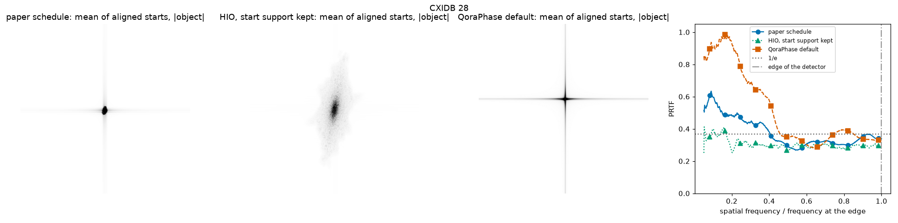

# Public measured data (CXIDB)

Generated by `benchmarks/cxidb.py` (method in its docstring).

## CXIDB 3

Status: not reproduced. The paper schedule and `default_recipe()` end on a cross through the centre; HIO with the start support kept fits the data, but its starts do not agree with each other. Suspected causes in #38.

- H. N. Chapman et al., Femtosecond diffractive imaging with a soft-X-ray free-electron laser, Nat. Phys. 2, 839 (2006), doi:10.1038/nphys461; data CXIDB 3, doi:10.11577/1096905
- the paper: Shrinkwrap with HIO, the support updated every 70 iterations at 0.2 of the maximum after a Gaussian blur going from 3 to 0.7 px FWHM by iteration 5000, 3000 to 4000 iterations, the mirror hole left free, no reality or positivity; the image is the average of 250 reconstructions, and its PRTF drops to 1/e at the edge of the CCD
- run 2026-10-27 09:04 Korea Standard Time, commit e71a17d
- Python 3.14.5, JAX 0.11.1, jaxlib 0.11.1, NumPy 2.5.2, qoraphase 0.2.0
- device cpu:0, x64 off
- Windows-11-10.0.26300-SP0, processor AMD64 Family 25 Model 97 Stepping 2, AuthenticAMD
- preparation: background (median of a 64 px border) subtracted, saturated pixels and their neighbours masked, the mirror hole masked to 45 px around the centre of symmetry (610.5, 688.5); cropped to 1220 x 1304 about the centre of symmetry, 9133 pixels masked; start support 172143 px
- start support for all three recipes: the blurred autocorrelation (sigma 12 px) above 3 times its median (`loose_support`); a fraction of its maximum keeps only the cross of the window-frame streaks (#38)
- paper schedule: 3500 HIO iterations (beta 0.9) with the paper's support updates, and 200 ER; HIO, start support kept: the same iterations with no support update; QoraPhase default: `default_recipe()`, 720 iterations
- PRTF over the aligned starts (shift to 1/10 px, phase, twin); its 1/e crossing as a fraction of the frequency at the edge of the detector

| recipe | starts | Fourier residual, median (best) | mutual error among starts, median | PRTF 1/e crossing / edge | s per start, incl. compile |
|---|---:|---:|---:|---:|---:|
| paper schedule | 10 | 0.422 (0.355) | 0.916 | 0.58 | 57 |
| HIO, start support kept | 10 | 0.065 (0.064) | 0.995 | below 1/e throughout | 56 |
| QoraPhase default | 10 | 0.485 (0.462) | 0.893 | 0.76 | 11 |

Physics check needed: the numbers are reported without interpretation.

## CXIDB 28

Status: not reproduced. The paper schedule ends on a small blob and `default_recipe()` on a cross through the centre, not the two clusters of the paper; HIO with the start support kept fits the data, but its starts do not agree with each other. The paper's 4 % autocorrelation support keeps 51 px (#38).

- S. Marchesini et al., X-ray image reconstruction from a diffraction pattern alone, Phys. Rev. B 68, 140101(R) (2003), doi:10.1103/PhysRevB.68.140101; data CXIDB 28, doi:10.11577/1172615
- the paper: the autocorrelation at 4 % as the first support, HIO (beta 0.9) with the beamstop region free, every 20 iterations a support at 0.2 of the maximum after a Gaussian blur of sigma 3 px, less 1 % per update down to 1.5 px; converged after a few hundred iterations, shown at 1000; resolution about 20 nm, no PRTF given
- run 2026-10-27 09:17 Korea Standard Time, commit fbc54db
- Python 3.14.5, JAX 0.11.1, jaxlib 0.11.1, NumPy 2.5.2, qoraphase 0.2.0
- device cpu:0, x64 off
- Windows-11-10.0.26300-SP0, processor AMD64 Family 25 Model 97 Stepping 2, AuthenticAMD
- preparation: as deposited (background already subtracted); the zero pixels masked; cropped to 1024 x 1020 about the centre of symmetry (511.5, 510.5), 56479 pixels masked; start support 94173 px
- start support for all three recipes: the blurred autocorrelation (sigma 12 px) above 3 times its median (`loose_support`); the paper's 4 % of the maximum keeps 51 px here, the failure of #38
- paper schedule: 2000 HIO iterations (beta 0.9) with the paper's support updates, and 200 ER; HIO, start support kept: the same iterations with no support update; QoraPhase default: `default_recipe()`, 720 iterations
- PRTF over the aligned starts (shift to 1/10 px, phase, twin); its 1/e crossing as a fraction of the frequency at the edge of the detector

| recipe | starts | Fourier residual, median (best) | mutual error among starts, median | PRTF 1/e crossing / edge | s per start, incl. compile |
|---|---:|---:|---:|---:|---:|
| paper schedule | 10 | 0.156 (0.144) | 0.979 | 0.41 | 20 |
| HIO, start support kept | 10 | 0.033 (0.032) | 0.997 | below 1/e throughout | 19 |
| QoraPhase default | 10 | 0.183 (0.171) | 0.910 | 0.46 | 6 |

Physics check needed: the numbers are reported without interpretation.
