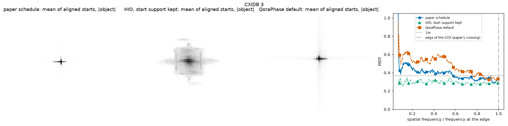

# Public measured data (CXIDB)

Generated by `benchmarks/cxidb.py` (method in its docstring).

## CXIDB 3

- H. N. Chapman et al., Femtosecond diffractive imaging with a soft-X-ray free-electron laser, Nat. Phys. 2, 839 (2006), doi:10.1038/nphys461; data CXIDB 3, doi:10.11577/1096905
- the paper: Shrinkwrap with HIO, the support updated every 70 iterations at 0.2 of the maximum after a Gaussian blur going from 3 to 0.7 px FWHM by iteration 5000, 3000 to 4000 iterations, the mirror hole left free, no reality or positivity; the image is the average of 250 reconstructions, and its PRTF drops to 1/e at the edge of the CCD
- run 2026-10-27 09:04 Korea Standard Time, commit e71a17d
- Python 3.14.5, JAX 0.11.1, jaxlib 0.11.1, NumPy 2.5.2, qoraphase 0.2.0
- device cpu:0, x64 off
- Windows-11-10.0.26300-SP0, processor AMD64 Family 25 Model 97 Stepping 2, AuthenticAMD
- preparation: background (median of a 64 px border) subtracted, saturated pixels and their neighbours masked, the mirror hole masked to 45 px around the centre of symmetry (610.5, 688.5); cropped to 1220 x 1304 about it, 9133 pixels masked
- paper schedule: 3500 HIO iterations (beta 0.9) with the support updated every 70, and 200 ER; HIO, start support kept: the same iterations with no support update; QoraPhase default: `default_recipe()`, 720 iterations
- start support for all three: the blurred autocorrelation (sigma 12 px) above 3 times its median (`loose_support`), not a fraction of its maximum, which here keeps only the cross of the window-frame streaks
- PRTF over the aligned starts (shift to 1/10 px, phase, twin), crossing of 1/e as a fraction of the frequency at the edge of the CCD

| recipe | starts | Fourier residual, median (best) | mutual error among starts, median | PRTF 1/e crossing / edge | s per start, incl. compile |
|---|---:|---:|---:|---:|---:|
| paper schedule | 10 | 0.422 (0.355) | 0.916 | 0.58 | 57 |
| HIO, start support kept | 10 | 0.065 (0.064) | 0.995 | 0.07 | 56 |
| QoraPhase default | 10 | 0.485 (0.462) | 0.893 | 0.76 | 11 |

Physics check needed: the numbers are reported without interpretation.
