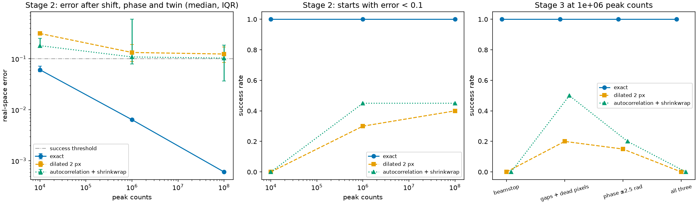

# Benchmark ladder

Generated by `benchmarks/ladder.py`; the method is in its docstring. Synthetic data only: these numbers say nothing about measured scans.

- run 2026-10-27 07:22 Korea Standard Time, commit 02c8299
- Python 3.14.5, JAX 0.11.1, jaxlib 0.11.1, NumPy 2.5.2, qoraphase 0.2.0
- device cpu:0, x64 off
- Windows-11-10.0.26300-SP0, processor AMD64 Family 25 Model 97 Stepping 2, AuthenticAMD
- object 128x128, 40-pixel triangular support, object seed 11, Poisson seed 23
- starts: `CDI.reconstruct(..., starts=20, seed=0)`, i.e. keys split from seed 0 (start indices 0 to 19); 720 iterations each
- success: real-space error < 0.1. This is an arbitrary threshold, not derived from the data; the median and IQR are given so another cut can be read off.
- stage 3 at 1e+06 peak counts: beamstop = disc of radius 4 px at zero frequency; gaps = a horizontal and a vertical 3-px gap 12 px off centre plus 0.5% dead pixels (seed 31); phase = the same object with phase within ±2.5 rad. Masked pixels read 0 and are left out of the fit and of the noise floor; the real-space error still covers the whole array.
- reproduce: `uv run --python 3.14+gil python benchmarks/ladder.py`; with a free-threaded 3.14 also installed, a plain `uv run` on Windows picked it and jaxlib has no wheel for it
- twin: starts whose twin matched the truth better than the start itself
- times: one vmapped call for all starts; a first call compiles only when its recipe is new to the run, so later rows show run time in both columns

| stage | peak counts | condition | support | success | twin | real-space error, median (IQR) | Fourier residual, median | residual / noise floor | first call s | warm s |
|---:|---:|---|---|---:|---:|---:|---:|---:|---:|---:|
| 1 | noiseless | - | exact | 20/20 | 0 | 1.11e-07 (1.06e-07 to 1.18e-07) | 1.36e-07 | n/a | 1.5 | 0.8 |
| 1 | noiseless | - | dilated 2 px | 4/20 | 0 | 1.37e-01 (1.19e-01 to 1.67e-01) | 8.20e-03 | n/a | 0.8 | 0.8 |
| 1 | noiseless | - | autocorrelation + shrinkwrap | 7/20 | 11 | 1.10e-01 (6.89e-02 to 4.92e-01) | 1.83e-02 | n/a | 1.5 | 0.9 |
| 2 | 1e+04 | - | exact | 20/20 | 0 | 6.10e-02 (5.58e-02 to 7.16e-02) | 9.69e-02 | 0.91 | 0.8 | 0.9 |
| 2 | 1e+04 | - | dilated 2 px | 0/20 | 0 | 3.13e-01 (3.05e-01 to 3.20e-01) | 9.76e-02 | 0.92 | 0.8 | 0.8 |
| 2 | 1e+04 | - | autocorrelation + shrinkwrap | 0/20 | 10 | 1.81e-01 (1.72e-01 to 2.51e-01) | 9.78e-02 | 0.92 | 0.8 | 0.9 |
| 2 | 1e+06 | - | exact | 20/20 | 0 | 6.40e-03 (6.40e-03 to 6.40e-03) | 1.43e-02 | 0.95 | 0.8 | 0.9 |
| 2 | 1e+06 | - | dilated 2 px | 6/20 | 0 | 1.33e-01 (8.90e-02 to 1.90e-01) | 1.56e-02 | 1.03 | 0.9 | 0.9 |
| 2 | 1e+06 | - | autocorrelation + shrinkwrap | 9/20 | 11 | 1.09e-01 (7.96e-02 to 5.96e-01) | 1.92e-02 | 1.28 | 0.8 | 0.8 |
| 2 | 1e+08 | - | exact | 20/20 | 0 | 6.05e-04 (6.05e-04 to 6.05e-04) | 1.30e-03 | 0.95 | 0.9 | 0.8 |
| 2 | 1e+08 | - | dilated 2 px | 8/20 | 0 | 1.24e-01 (8.46e-02 to 1.72e-01) | 6.97e-03 | 5.10 | 0.8 | 0.9 |
| 2 | 1e+08 | - | autocorrelation + shrinkwrap | 9/20 | 14 | 1.03e-01 (3.67e-02 to 1.86e-01) | 1.32e-02 | 9.66 | 0.9 | 0.8 |
| 3 | 1e+06 | beamstop | exact | 20/20 | 0 | 6.42e-03 (6.42e-03 to 6.42e-03) | 2.57e-02 | 0.95 | 0.9 | 0.9 |
| 3 | 1e+06 | beamstop | dilated 2 px | 0/20 | 0 | 2.26e-01 (2.07e-01 to 2.39e-01) | 3.06e-02 | 1.13 | 0.9 | 0.9 |
| 3 | 1e+06 | beamstop | autocorrelation + shrinkwrap | 0/20 | 10 | 9.28e-01 (9.15e-01 to 9.32e-01) | 4.04e-01 | 14.92 | 0.8 | 0.8 |
| 3 | 1e+06 | gaps + dead pixels | exact | 20/20 | 0 | 7.03e-03 (7.03e-03 to 7.03e-03) | 1.40e-02 | 0.94 | 0.9 | 0.8 |
| 3 | 1e+06 | gaps + dead pixels | dilated 2 px | 4/20 | 0 | 1.33e-01 (1.19e-01 to 1.91e-01) | 1.56e-02 | 1.06 | 1.0 | 0.9 |
| 3 | 1e+06 | gaps + dead pixels | autocorrelation + shrinkwrap | 10/20 | 13 | 9.93e-02 (7.14e-03 to 2.65e-01) | 1.84e-02 | 1.24 | 0.9 | 0.9 |
| 3 | 1e+06 | phase ±2.5 rad | exact | 20/20 | 0 | 5.22e-03 (5.22e-03 to 5.22e-03) | 1.14e-02 | 0.95 | 0.9 | 0.9 |
| 3 | 1e+06 | phase ±2.5 rad | dilated 2 px | 3/20 | 0 | 1.79e-01 (1.33e-01 to 2.24e-01) | 1.55e-02 | 1.29 | 0.9 | 0.9 |
| 3 | 1e+06 | phase ±2.5 rad | autocorrelation + shrinkwrap | 4/20 | 10 | 4.45e-01 (1.34e-01 to 6.56e-01) | 7.59e-02 | 6.31 | 0.9 | 0.9 |
| 3 | 1e+06 | all three | exact | 20/20 | 0 | 5.58e-03 (5.58e-03 to 5.58e-03) | 1.66e-02 | 0.95 | 0.8 | 0.9 |
| 3 | 1e+06 | all three | dilated 2 px | 0/20 | 0 | 2.14e-01 (1.96e-01 to 7.66e-01) | 2.73e-02 | 1.56 | 0.9 | 0.9 |
| 3 | 1e+06 | all three | autocorrelation + shrinkwrap | 0/20 | 5 | 9.32e-01 (9.21e-01 to 9.37e-01) | 4.13e-01 | 23.59 | 0.9 | 1.0 |

## Not compared

PyNX: the `pynx` package on PyPI is an unrelated project, and ESRF PyNX (gitlab.esrf.fr/favre/PyNX) depends on `pyvkfft`, which needs an OpenCL or CUDA toolkit to build and has no Windows wheel. A comparison on a Linux machine with a GPU toolkit would be separate work.
