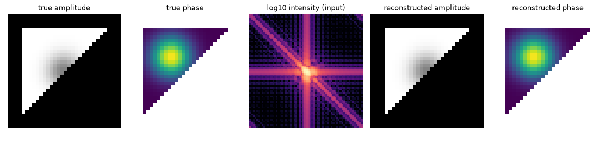

# Overview

A diffraction detector measures **how bright each part of a pattern is**, but
not the phase of the scattered X-ray wave. Without that phase, the pattern
cannot simply be Fourier-transformed into an image of the object. This is the
*phase-retrieval problem* in coherent diffraction imaging (CDI).

**QoraPhase estimates a possible object from the measured intensity.** It
iterates between diffraction-space measurements and real-space constraints
using algorithms such as ER, HIO, RAAR, and shrinkwrap. The result is a
complex-valued object: amplitude and phase. It accepts centred 2D or 3D
NumPy/JAX arrays, and can run on CPU or GPU.

A reconstruction that matches the measured intensity is **not automatically
the correct or unique object**. The synthetic example and measured-data
checks below show both what the code can do and what remains unresolved.

A 64×64 simulated object, its noiseless intensity, and the best of 8 random
starts from `qp.reconstruct(intensity, starts=8)` with no support given (it is
derived from the autocorrelation and shrinkwrapped). Relative error against the
true object: 7.9e-7. Script: `examples/readme_figure.py`. This is a recorded synthetic example, not a new measured-data result.

## Start here

Read [installation](install.md), the [tutorial](tutorial.md) and [array conventions](guides/arrays.md). Then use [recipes](guides/recipes.md), [constraints](guides/constraints.md), [diagnostics](guides/diagnostics.md) and [alignment/PRTF](guides/combining.md).

Manual benchmark reproduction is in [genetic algorithms](guides/genetic.md) and [low-pass progression](guides/low-pass.md). Read the [validation limits](guides/validation.md), [report index](reports/README.md) and [release history](https://github.com/NaNIsaac/QoraPhase/releases) before interpreting results. The documentation hub generates API reference pages from the package docstrings.
